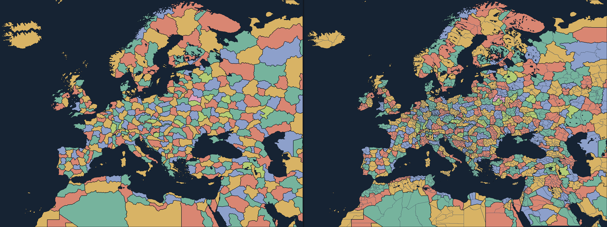
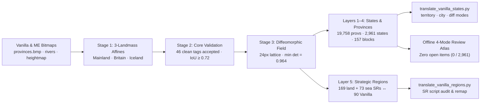
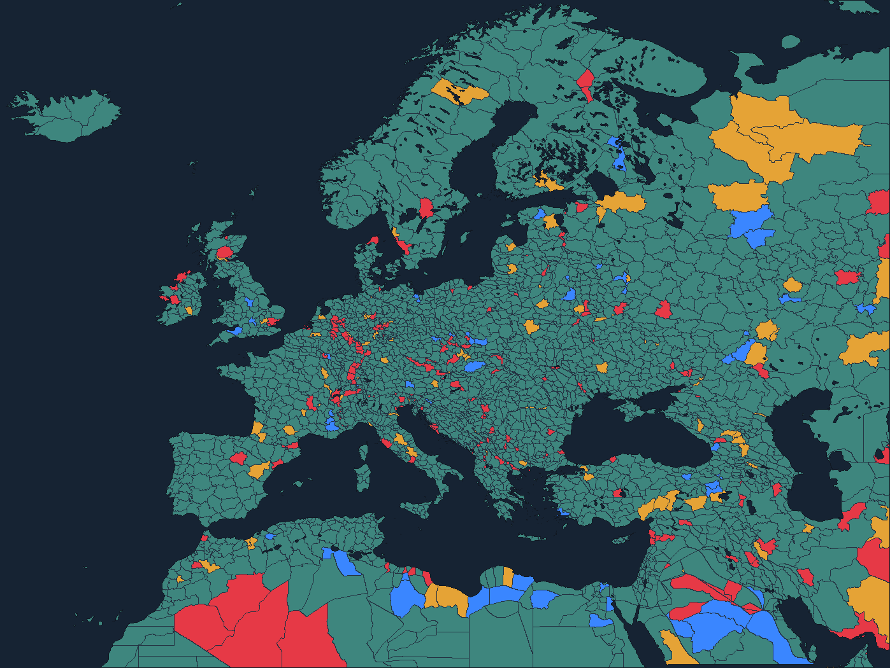
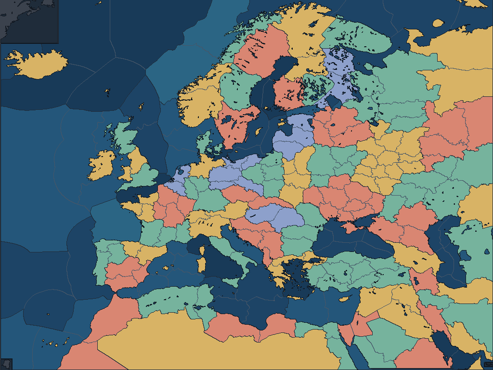

# Vanilla HOI4 ↔ Magna Europa Definitive Map Crosswalk

**English** | [简体中文](README_zh-CN.md)

**A zero-circularity, diffeomorphic, multi-layer geometric & semantic crosswalk bridging Vanilla *Hearts of Iron IV* onto Magna Europa's 3.14×-upscaled European & MENA grid.**

[Architecture & Benchmarks](methodology.md) · [Content-Porter CLI Guide](guide.md) · [Interactive Atlas](atlas.md) · [Raw Truth Tables](../states/README.md)

---

## Why This Exists

Magna Europa rebuilds Europe, North Africa, and the Middle East on a **~3.14× finer grid** (`2,961` European/MENA states and `19,758` land provinces vs. `464` Vanilla states in the same theater). Porting Vanilla + DLC focus trees, decisions, events, AI strategies, and strategic regions onto that map cannot rely on name matching or historical comments alone — `legacy_audit` caught **204 distant or wrong-owner legacy mis-mappings** (including states mapped 100–2,400 px away to Western Australia or French Somaliland, or Siberia homonyms like Sverdlovsk).

To solve this permanently without circularity, we built a **physical-feature registration pipeline** driven strictly by coastlines, 1936 borders, river skeletons, heightmaps, and geometry-validated cores — never touching Victory Points, state names, or legacy comments during the warp — then distilled the result into **5 canonical crosswalk layers** plus zero-dependency Python translators.

---

## Visual Overview: Parent-Color Alignment

Every European/MENA state in **Vanilla** (left, `464` states) is colored with an 8-color graph coloring; every **Magna Europa** state (right, `2,961` states) inherits its assigned Vanilla parent's exact hue, with bold dark borders tracing preserved macro Vanilla state boundaries and fine slate lines showing ME's internal subdivision:

> [!TIP]
> Notice how **10** Parisian sub-states (`571` Paris + 9 Île-de-France states), **21** Brandenburg sub-states (`1650` Ost-Berlin + surroundings), **16** Lazio sub-states (`876` Centro di Roma + surroundings), and **8** Moscow / **5** Stalingrad sub-states lock tightly onto their parent footprints with zero boundary bleed.

---

## How the 5-Layer Crosswalk Works

### Canonical Crosswalk Layers (`docs/states/eu_mapping/`)

| Layer | Table | Scope & Count | What It Answers |
| :---: | --- | --- | --- |
| **1** | [`prov_m2v.tsv`](../states/eu_mapping/prov_m2v.tsv) / [`prov_v2m.tsv`](../states/eu_mapping/prov_v2m.tsv) | `19,758` ME land provs ↔ `464` Vanilla states | Exact province-level pixel overlap (`79.8%` pure `≥95%`), supply/railways, province transfers |
| **2** | [`state_overlap.tsv`](../states/eu_mapping/state_overlap.tsv) | `5,658` weighted `(vanilla_id, me_id)` edges | Full many-to-many overlaps (`interior`, `majority`, `straddler`, `minor`, `sliver`) |
| **3** | [`state_partition_m2v.tsv`](../states/eu_mapping/state_partition_m2v.tsv) / [`state_partition_v2m.tsv`](../states/eu_mapping/state_partition_v2m.tsv) | `2,961` mapped + `25` excluded ↔ `464` Vanilla (`157` aligned blocks) | Gap-free, overlap-free state partition for territorial transfers, cores, claims, and peace/events |
| **4** | [`state_primary_city.tsv`](../states/eu_mapping/state_primary_city.tsv) | `464` Vanilla states → `464` single `1→1` ME city states | Single-target industrial focuses, building slots, capitals, wonders, and resource spawns |
| **5** | [`region_partition_m2v.tsv`](../states/eu_mapping/region_partition_m2v.tsv) / [`region_partition_v2m.tsv`](../states/eu_mapping/region_partition_v2m.tsv) | `253` ME SRs (`169` land + `73` sea + `11` excluded) ↔ `99` Vanilla | Land + naval/air strategic regions (`ai_strategy`, airwings, naval zones, weather triggers) |

### Which Layer Should I Use?

| If your HOI4 script does… | Use mode / layer | Why |
| --- | --- | --- |
| `transfer_state`, `add_core_of`, `owns_state`, border treaties | **Layer 3** (`--mode territory`) | Emits the full disjoint cell; when multiple Vanilla states form a union (`42 + 51 + 978`), internal straddlers auto-merge cleanly |
| `add_building_construction`, `add_extra_state_shared_building_slots`, `set_capital`, `add_resource` | **Layer 4** (`--mode city`) | Prevents 5×–20× factory inflation by collapsing a subdivided Vanilla state to its primary city (`327` spatial VP matches, `39` capitals) |
| `set_province_controller`, railway chains, canals, fortification lines | **Layer 1** (`--provinces`) | Resolves exact individual provinces without pulling in the whole state |
| `strategic_region = N`, `region = N`, naval patrol / air superiority AI | **Layer 5** (`translate_vanilla_regions.py`) | Separate strategic-region grid covering both land (`169`) and projected sea (`73`) SRs |

---

## Iconic WW2 State Subdivisions

| Vanilla State | Vanilla Name | ME Sub-States | Layer 4 Primary City | Basis |
| :---: | --- | :---: | --- | --- |
| `16` | Île-de-France (`FRA`) | **10** | `571` Paris | National Capital (`FRA`) |
| `126` | Greater London Area (`ENG`) | **8** | `2475` London | National Capital (`ENG`) |
| `64` | Brandenburg (`GER`) | **21** | `1650` Ost-Berlin | National Capital (`GER`) |
| `42` | Moselland (`GER`) | **14** | `537` Saarland | Spatial VP Match |
| `51` | Rhineland (`GER`) | **15** | `1749` Essen-Duisburg | Spatial VP Match |
| `2` | Lazio (`ITA`) | **16** | `876` Centro di Roma | National Capital (`ITA`) |
| `10` | Warsaw (`POL`) | **6** | `508` Warszawa | National Capital (`POL`) |
| `219` | Moscow (`SOV`) | **8** | `229` Moskva | National Capital (`SOV`) |
| `195` | Leningrad (`SOV`) | **4** | `119` Leningrad | Spatial VP Match |
| `217` | Stalingrad (`SOV`) | **5** | `457` Stalingrad | Spatial VP Match |

---

## Verification, Adjudications & Legacy Error Rescue

**Map Color Legend** (all `2,961` European/MENA ME states — `0` open items remaining in [`review_queue.tsv`](../states/eu_mapping/review_queue.tsv)):
- **Coral Red (`#e63946`)** — `204` **Rescued Legacy Errors** (`legacy_distant_error` `140` + `legacy_wrong_owner` `64` caught vs. legacy `m2v_states.tsv`, including `6` adjudicated + `10` straddler/island + `188` high-confidence states)
- **Sky Blue (`#3a86ff`)** — `53` additional **Human-Adjudicated** states (`59` total in [`adjudications.tsv`](../states/eu_mapping/adjudications.tsv): `7` overrides + `52` confirmations)
- **Warm Amber (`#e5a336`)** — `107` additional **Resolved Straddlers & Offshore Islands** (`99` straddlers + `18` fallback islands total across non-legacy-error tiers)
- **Sage Teal (`#3e867e`)** — `2,597` additional **High-Confidence Automatic** states (`2,785` total before red overlay: `2,261` interior + `318` majority + `206` core-locked)

### Highlights from `204` Caught Legacy Errors ([`legacy_audit.tsv`](../states/eu_mapping/legacy_audit.tsv))

| ME State | Legacy Mis-Mapping (`legacy_v_id`) | Distance | Definitive New Mapping | Share | Failure Mode |
| --- | --- | :---: | --- | :---: | --- |
| `194` Perth (`ENG`) | `v522` Western Australia (`manual`) | `2,406.5 px` | `v136` Aberdeenshire | `40.2%` | Typo / wrong-continent manual ID |
| `2851` Haute-Savoie (`FRA`) | `v268` French Somaliland (`comment`) | `812.3 px` | `v735` Savoy | `100.0%` | Stale `# was vanilla 268` comment |
| `2309` Sverdlovsk (`SOV`) | `v653` Sverdlovsk (`name-singleton`) | `360.3 px` | `v218` Rostov | `75.6%` | Donbass town vs. Urals Sverdlovsk homonym |
| `2029` Rovenki (`SOV`) | `v651` Ufa (`pixel-geo`) | `254.5 px` | `v228` Voroshilovgrad | `88.2%` | Legacy coarse warp drift |
| `2516` Akhtubinsk (`SOV`) | `v402` Akhtubinsk (`manual`) | `132.5 px` | `v236` Astrakhan | `90.5%` | Manual cross-state shift |
| `1306` Tindouf (`FRA`) | `v513` Tlemcen (`comment(member)`) | `115.1 px` | `v514` Algerian Desert | `98.9%` | Comment attribution across desert border |

---

## Layer 5: Strategic Regions Crosswalk (Land + Sea)

Using Layer 1 `prov_m2v` on land and Stage-1 affine projection on water pixels from `provinces.bmp`, **Layer 5** bridges all `253` ME strategic regions to Vanilla (`169` mapped land + `72` auto-projected sea + `1` explicit Arabia canal-strip sea override `188 → v104` + `11` excluded NA inset, Congo/Indonesia proxy, and MAP border SRs):

> Warm cartographic hues represent the `169` mapped land SRs grouped by Vanilla land parent (`2px` border hierarchy marks macro Vanilla SR vs. subdivided ME SRs); oceanic blues represent the `73` mapped sea SRs; muted charcoal/slate marks the `11` excluded inset/proxy SRs.

---

## Documentation Directory

| Page | Contents |
| --- | --- |
| [**Technical Architecture & Schema**](methodology.md) | 3-landmass decoupled affines, 46 core validations, Jacobian-guarded diffeomorphic residual field, full Stage 1→3 benchmarks, and exact TSV schemas for Layers 1–5 |
| [**Submodder & Content-Porter Guide**](guide.md) | Zero-dependency Python CLI commands (`translate_vanilla_states.py`, `translate_vanilla_regions.py`, `audit_eu_script_refs.py`) with real outputs & HOI4 script recipes |
| [**Offline Review Atlas Guide**](atlas.md) | How to launch and use the 4-mode interactive HTML map viewer ([`../states/eu_mapping/review/index.html`](../states/eu_mapping/review/index.html)) |
| [**Raw Mapping & Evidence Directory**](../states/README.md) | Upstream ledger schemas, conservative auto-repair pipeline, and full regeneration chain |
