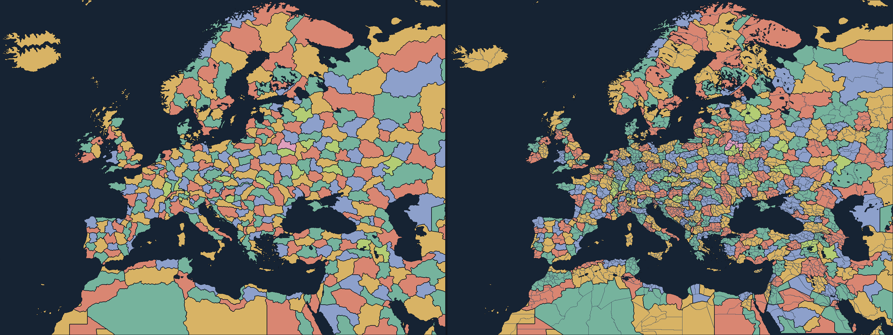
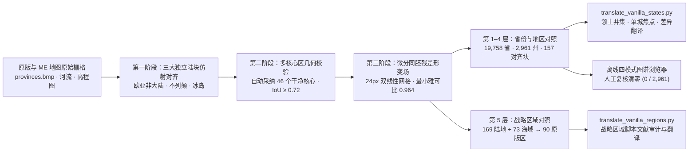
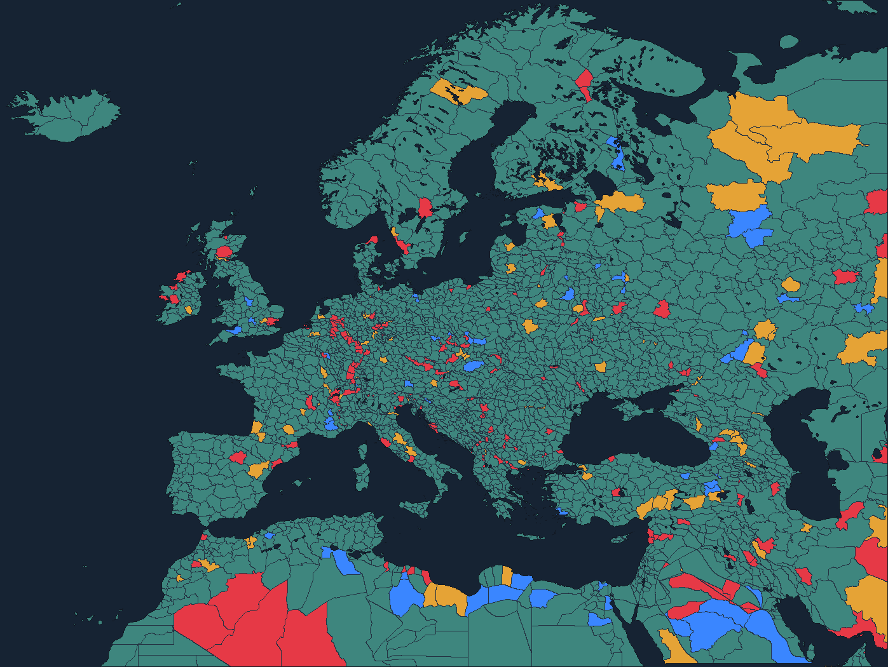
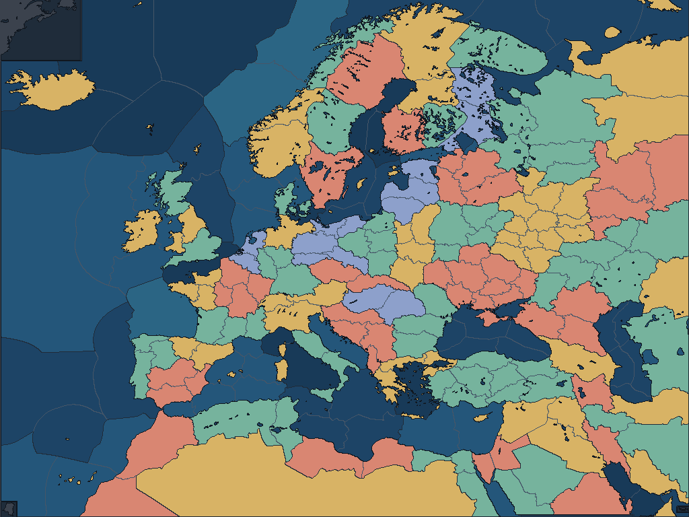

# 原版 HOI4 ↔ Magna Europa 权威地图映射专题

[English](README.md) | **简体中文**

**一套零循环依赖、保持微分同胚的多层几何与语义地图对照体系，将《钢铁雄心4》原版与全 DLC 内容精确桥接至 Magna Europa 放大约 3.14 倍的欧洲/中东北非高密度网格。**

[技术架构与量化基准](methodology.md) · [移植脚本 CLI 实战指南](guide.md) · [离线交互图谱浏览器](atlas.md) · [底层真值表仓库说明](../states/README.md)

---

## 为什么要重建这套映射？

Magna Europa 在保持欧洲—北非—中东主战场范围的前提下，把地图细节放大了约 **3.14 倍**（主图共 `2,961` 个地区、`19,758` 个陆地省份，对应同区域原版 `464` 个地区）。把原版及全 DLC 的国策、事件、决议、AI 策略与战略区域迁移到这套网格上时，不能只靠地名或 `# was vanilla N` 注释启发式匹配——`legacy_audit` 对历史旧表的全面体检一共抓出了 **204 个远距或错主的严重旧表错配**（包括将苏格兰珀斯错标到西澳大利亚、法属萨瓦错标到法属索马里兰，以及把顿巴斯的斯维尔德洛夫斯克重名匹配到乌拉尔等）。

为此，我们设计了一套**严格无循环验证**的纯物理形变配准管线：配准过程中绝不读取胜利点、州名或旧移植注释，只用海岸线、1936 年国界、河流骨架、高程图与几何校验过的核心标签求解形变场，最终沉淀为 **5 层标准对照表** 与纯 Python 标准库即开即用的自动翻译工具。

---

## 全局直观对比：原版父级染色对照图

左图为**原版 HOI4**（`464` 个欧/中东北非州）经 8 色图论染色的标准底图；右图为 **Magna Europa**（`2,961` 个细分州）严格继承各自归属的原版父州同款颜色——粗黑线精确勾勒出未发生越界的原版宏区轮廓，细灰线则展现 ME 内部的精细划分：

> [!TIP]
> 可以清晰看到：法兰西岛划分出的 **10** 个州（`571` 巴黎及周边）、勃兰登堡拆分出的 **21** 个州（`1650` 东柏林及周边）、拉齐奥拆分出的 **16** 个州（`876` 罗马城中心及周边）、莫斯科 **8** 州与斯大林格勒 **5** 州，全部严谨落回各自原版父州边界以内。

---

## 五层映射管线与工作流

### 五层核心产出一览（[`docs/states/eu_mapping/`](../states/eu_mapping/)）

| 层级 | 文件 | 粒度与规模 | 核心用途 |
| :---: | --- | --- | --- |
| **Layer 1** | [`prov_m2v.tsv`](../states/eu_mapping/prov_m2v.tsv) / [`prov_v2m.tsv`](../states/eu_mapping/prov_v2m.tsv) | `19,758` 个 ME 陆地省 ↔ `464` 原版州 | 精确到省份像素的面积占比（`79.8%` 纯度 `≥95%`），用于铁路/补给/运河/单省控制权 |
| **Layer 2** | [`state_overlap.tsv`](../states/eu_mapping/state_overlap.tsv) | `5,658` 条带权 `(vanilla_id, me_id)` 交叠边 | 完整多对多交叠关系（`interior` / `majority` / `straddler` / `minor` / `sliver`） |
| **Layer 3** | [`state_partition_m2v.tsv`](../states/eu_mapping/state_partition_m2v.tsv) / [`state_partition_v2m.tsv`](../states/eu_mapping/state_partition_v2m.tsv) | `2,961` 已映射 + `25` 显式排除 ↔ `464` 原版（`157` 个对齐块） | 无遗漏、不重叠的整州划分，用于割地 `transfer_state`、加核心、宣称与和会事件 |
| **Layer 4** | [`state_primary_city.tsv`](../states/eu_mapping/state_primary_city.tsv) | `464` 原版州 → `464` 唯一 `1→1` ME 主城市州 | 一对一代表州，防止加建筑/工业槽/首都/资源刷出后被乘以 5–20 倍 |
| **Layer 5** | [`region_partition_m2v.tsv`](../states/eu_mapping/region_partition_m2v.tsv) / [`region_partition_v2m.tsv`](../states/eu_mapping/region_partition_v2m.tsv) | `253` ME 战略区（`169` 陆地 + `73` 海域 + `11` 排除）↔ `99` 原版 | 陆地与海空战略区域对照，服务 `ai_strategy`、空军任务区、海域判定 |

### 写脚本该查哪一层？

| 目标脚本语义 | 推荐层 / CLI 模式 | 原因 |
| --- | --- | --- |
| `transfer_state`、`add_core_of`、`owns_state`、停战割地条约 | **Layer 3**（`--mode territory`） | 输出完整互不相交的州集；多个原版州合并翻译（如莱茵三州）时自动融合内部跨界州 |
| `add_building_construction`、建筑槽、`set_capital`、`add_resource` | **Layer 4**（`--mode city`） | 为每个原版州精选唯一代表城市州（含 `327` 次 VP 空间匹配与全部 `39` 座首都），杜绝数值膨胀 |
| `set_province_controller`、铁路网、要塞线、海峡运河 | **Layer 1**（`--provinces`） | 精准定位单个省份，不误伤同州其余格子 |
| `strategic_region = N`、`region = N`、海军巡逻/夺取制空 AI | **Layer 5**（`translate_vanilla_regions.py`） | 覆盖陆地（`169`）与仿射投影海域（`73`）的独立战略区交叉表 |

---

## 经典二战重点州拆分示例

| 原版州 ID | 原版名称 | ME 拆分州数 | Layer 4 唯一主城州 | 选点依据 |
| :---: | --- | :---: | --- | --- |
| `16` | 法兰西岛 (`FRA`) | **10** | `571` Paris | 国家首都 (`FRA`) |
| `126` | 大伦敦 (`ENG`) | **8** | `2475` London | 国家首都 (`ENG`) |
| `64` | 勃兰登堡 (`GER`) | **21** | `1650` Ost-Berlin | 国家首都 (`GER`) |
| `42` | 摩泽尔兰 (`GER`) | **14** | `537` Saarland | 胜利点空间匹配 |
| `51` | 莱茵兰 (`GER`) | **15** | `1749` Essen-Duisburg | 胜利点空间匹配 |
| `2` | 拉齐奥 (`ITA`) | **16** | `876` Centro di Roma | 国家首都 (`ITA`) |
| `10` | 华沙 (`POL`) | **6** | `508` Warszawa | 国家首都 (`POL`) |
| `219` | 莫斯科 (`SOV`) | **8** | `229` Moskva | 国家首都 (`SOV`) |
| `195` | 列宁格勒 (`SOV`) | **4** | `119` Leningrad | 胜利点空间匹配 |
| `217` | 斯大林格勒 (`SOV`) | **5** | `457` Stalingrad | 胜利点空间匹配 |

---

## 质量校验、人工复核与 204 处历史错配抢救

**图例说明**（涵盖欧洲/中东北非全部 `2,961` 个地区，[`review_queue.tsv`](../states/eu_mapping/review_queue.tsv) 未决数已清零为 `0`）：
- **珊瑚红 (`#e63946`)** —— **204 个从旧表误配中纠正的地区**（在 [`legacy_audit.tsv`](../states/eu_mapping/legacy_audit.tsv) 中检出 `140` 个远距错误 + `64` 个跨国错主；含 `6` 个兼作人工裁决、`10` 个兼属跨界/海岛、`188` 个高置信州）
- **天蓝 (`#3a86ff`)** —— 其余 `53` 个 **人工最终裁决州**（[`adjudications.tsv`](../states/eu_mapping/adjudications.tsv) 总计 `59` 项人工审定：`7` 项人工覆写 + `52` 项审定确认）
- **琥珀金 (`#e5a336`)** —— 其余 `107` 个 **跨界州 / 离岸海岛自动仲裁**（`99` 个跨界州与 `18` 个回退海岛的其余部分）
- **鼠尾草青 (`#3e867e`)** —— 其余 `2,597` 个 **高置信自动锁定州**（全图共计 `2,785` 个高置信州：`2,261` 完全内含 + `318` 多数占优 + `206` 核心锁死）

### 代表性旧表错配抢救案例（[`legacy_audit.tsv`](../states/eu_mapping/legacy_audit.tsv)）

| ME 地区 | 旧表错误映射 (`legacy_v_id`) | 偏移距离 | 新权威映射 | 面积占比 | 错因归类 |
| --- | --- | :---: | --- | :---: | --- |
| `194` 珀斯 (`ENG`) | `v522` 西澳大利亚 (`manual`) | `2,406.5 px` | `v136` 阿伯丁郡 | `40.2%` | 手工填表写错大洲 ID |
| `2851` 上萨瓦 (`FRA`) | `v268` 法属索马里兰 (`comment`) | `812.3 px` | `v735` 萨瓦 | `100.0%` | 过时的 `# was vanilla 268` 注释 |
| `2309` 斯维尔德洛夫斯克 (`SOV`) | `v653` 斯维尔德洛夫斯克 (`name-singleton`) | `360.3 px` | `v218` 罗斯托夫 | `75.6%` | 顿巴斯同名城镇被乌拉尔大城吸走 |
| `2029` 罗韦尼基 (`SOV`) | `v651` 乌法 (`pixel-geo`) | `254.5 px` | `v228` 伏罗希洛夫格勒 | `88.2%` | 旧版粗糙形变场漂移 |
| `2516` 阿赫图宾斯克 (`SOV`) | `v402` 阿赫图宾斯克 (`manual`) | `132.5 px` | `v236` 阿斯特拉罕 | `90.5%` | 手工维护遗留错位 |
| `1306` 廷杜夫 (`FRA`) | `v513` 特莱姆森 (`comment(member)`) | `115.1 px` | `v514` 阿尔及利亚沙漠 | `98.9%` | 撒哈拉跨界注释牵连误归 |

---

## 第 5 层：陆地 + 海域全战略区域对照

陆地战区直接基于 Layer 1 省份对照表像素加权汇总，海域战区则将 `provinces.bmp` 海洋像素经第一阶段仿射矩阵投影至原版海域。**第 5 层**实现了全部 `253` 个 ME 战略区域与原版的完整对接（`169` 个映射陆地区 + `72` 个投影海域区 + `1` 个南部阿拉伯海峡边界手工覆写 `188 → v104` + `11` 个北美插图/刚果/印尼代理与 `MAP` 边界显式排除区）：

> 暖色调展示按原版陆地战区统一着色的 `169` 个陆地战略区（深灰线区隔不同原版父区，浅灰细线区隔同父区内部细分）；海蓝色系展示按原版海域着色的 `73` 个海域区；左上北美插图与左下/右下代理方框以深灰暗色明确剥离主图范围。

---

## 专题子文档导航

| 文档 | 内容介绍 |
| --- | --- |
| [**技术架构与数据结构说明**](methodology.md) | 三大独立陆块仿射参数、46 个核心标签校验、雅可比保形残差形变场、Stage 1→3 量化评测及 Layer 1–5 完整 TSV 字段表（English） |
| [**内容移植与审计 CLI 实用指南**](guide.md) | 零第三方依赖的 `translate_vanilla_states.py` / `translate_vanilla_regions.py` / `audit_eu_script_refs.py` 实操命令与真实输出示例（English） |
| [**离线交互图谱浏览器指南**](atlas.md) | 如何离线打开并操作四模式地图浏览器 [`../states/eu_mapping/review/index.html`](../states/eu_mapping/review/index.html)（English） |
| [**底层真值表仓库规范**](../states/README.md) | 关系证据账本、保守自动修复规则及全链条重建指令（English） |
