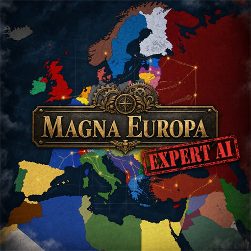

<div align="center">



# Expert AI for Magna Europa: Reforged


[](https://steamcommunity.com/sharedfiles/filedetails/?id=3845750082)

**English** | [简体中文](README_zh-CN.md)

**A standalone AI overhaul submod built specifically for [Magna Europa: Reforged](https://steamcommunity.com/sharedfiles/filedetails/?id=3809580289).**

**Upgrades AI national management, production, division design, espionage, and theater-level operations across Magna Europa's 2,986-state European map — with zero stat cheats on Standard difficulty.**

</div>

> [!NOTE]
> **Standalone Submod & Tribute**: This project is inspired by and pays tribute to the architectural philosophy of **Expert AI 5.0** (scripted state machines, meta equipment designs, structured templates, soft division caps, operational sectors, and intel counter-adaptation). Every script, template, strategy plan, and map dataset here is written from scratch for **Magna Europa: Reforged** — **you do not need to subscribe to vanilla Expert AI 5.0**.

> [!IMPORTANT]
> **Fair Challenge by Default**: On the default **Standard** difficulty, the AI receives **0% hidden stat, production, or manpower bonuses**. All opt-in difficulty modifiers (`Challenging`, `Brutal`, and targeted bloc boosts) are disabled unless explicitly turned on via Custom Game Rules or the in-game Control Panel.

---

## Why This Submod Exists

Magna Europa expands the European theater to **2,986 states, ~21,600 provinces, and 253 strategic regions** — roughly 2–2.5× the frontline density and logistical depth of vanilla Hearts of Iron IV. Standard AI scripts frequently struggle on this scale with:

- Poor focus ordering, advisor/MIO selection, and DLC mechanic handling (MEFO/Economy of Conquest, Stalin's Paranoia, espionage, synthetic rubber).
- Outdated equipment blueprints, supply-heavy division bloat, and late-game performance degradation.
- Passive or unfocused frontlines that fail to concentrate armor and air power on key railway supply hubs.

**Expert AI for Magna Europa: Reforged** replaces base-mod AI pacing cleanly via the `MER_EAI_enabled` takeover flag and provides a dedicated, map-aware AI brain tuned specifically for Magna Europa's geography and balance.

---

## Features

### 1. Country-Level Economic & Political AI

- **Germany (Historical Four-Year Plan)**:
  - Follows the historical *Four-Year Plan* path with active `MEFO Bills` / `Economy of Conquest` consumer-goods control, including seizing European French gold reserves on capitulation prior to the Vichy partition (paying full PP and resistance/compliance costs).
  - Optimizes Inner Circle progression (`Hess → Goebbels → Todt`, transitioning to `Speer` via the historical rivalry event) while avoiding low-value picks.
  - Uses lightweight pure-cavalry garrison templates to eliminate support-equipment attrition bleed, assigns deterministic MIOs, runs Collaboration Governments against France and the USSR, and maintains Atlantic Wall coastal defenses.
- **Soviet Union (Historical Line)**:
  - Schedules Great Purge focuses and paranoia decisions (`Forge Production Reports`, with `Inspection in the Navy` as a last-resort fallback) to keep paranoia below the random-purge threshold — avoiding random Army and Air Force purges and preserving aircraft design bureaus.
  - Completes *Behead the Snake* early and prioritizes the Trotsky assassination operation to remove the early stability and political-power penalty years ahead of vanilla AI.
  - Builds inland synthetic rubber refineries (outside front-line Ukrainian/Belarusian states) and researches rubber processing to resolve Magna Europa's natural rubber scarcity for Soviet aircraft and motorized production.
  - Completes the Red Air Force reform branch before Barbarossa, preserves an authentic initial 1941 Barbarossa vulnerability (no pre-war fortification along the Dnieper), and pivots immediately on war declaration to *Desperate Measures → Move Industry to the Urals → Defense of Moscow → Lessons of War* alongside sustained training-queue reserves.
- **Italy, Allies & Minor Powers**:
  - Coordinated land, air, and naval focus for Italy in Greece, the Balkans, and North Africa.
  - Allied theater prioritization favoring North Africa (*Operation Torch*) before full-scale Western European landings, plus Lend-Lease coordination from the US and UK.
  - Upgraded historical focus ordering and economic mobilization for major European powers (`ENG`, `USA`, `FRA`, `ITA`, `POL`, `ROM`, `HUN`).

### 2. Equipment Designs, Templates & Production Loop

- **Meta Land, Air & Naval Blueprints**: Up-to-date medium tank, flame tank, fighter, CAS, and major-power naval designs (for `ITA`, `ENG`, `USA`) aligned with NSB, BBA, and MtG designers.
- **Supply-Aware Division Templates**: Standardized infantry, motorized, heavy medium-armor, mountaineer, marine, and garrison templates tuned for Magna Europa's supply hubs and combat widths.
- **Dynamic Deficit Loop with Hysteresis**: Monitors stockpile ratios and active field deficits (rifles, artillery, anti-tank, anti-air, support, trucks, trains, tanks, fighters, CAS) using Schmitt-trigger hysteresis so production lines maintain high factory efficiency instead of thrashing.
- **Soft Division Caps**: Keeps army counts scaled to Magna Europa's 2–2.5× frontage while capping late-game division bloat and redirecting excess industry into armor and air superiority.

### 3. Map-Aware Operational Warfare

- **Precompiled CSR Map Graphs**: Offline Python compiler (`tools/build_eai_map_graph.py`) exports compressed sparse row (CSR) adjacency tables for all 2,986 states and 253 strategic regions directly into static script arrays — zero `meta_effect` overhead at runtime.
- **Railway-Hub Offensive Coordination**: Major powers dynamically identify priority enemy supply hubs along active fronts, concentrate armored spearheads and tactical air cover across 13 European operational sectors, and rotate stalled offensives cleanly.
- **Wartime-Only River Fortifications**: Modest, CIV-paid directional bunkers along 7 historical European river lines (Rhine, Vistula, Dnieper, Volga, Don, Po, Danube) constructed only under active wartime threat.
- **Espionage & Counter-Intelligence**: Purposeful La Résistance agency upgrades (cryptography, operations, extra operatives), cipher capture, combat intel networks, Collaboration Governments, and Soviet counter-intelligence.

### 4. Performance Architecture

- **Zero hourly loops** and **zero daily full-map scans**.
- **3-Tier Country Funnel**: Tier 1 (major powers) runs weekly tactical pulses + monthly strategy updates; Tier 2 (industrial regionals) runs compact monthly updates; Tier 3 (minor states) stays dormant under lightweight caps.
- **28-Day Staggered Scheduler**: Spreads monthly evaluations across 28 slots so only 1–2 AI nations evaluate per game day, driven exclusively by `O(1)` country flags.

---

## Difficulty & Configuration

Configure settings before starting a campaign under **Custom Game Rules → Expert AI for Magna Europa**, or change them live anytime through the human-only **Expert AI: Control Panel** decision category (which can also be hidden for a cleaner UI):

| Setting | Options | Notes |
|---|---|---|
| **Global Difficulty Tier** | `Standard` (default) / `Challenging` / `Brutal` / `Custom` | `Standard` applies **no stat modifiers**. `Challenging` adds `+15%` AI industry/logistics; `Brutal` adds `+30%` industry, `+10%` combat, `+25%` manpower. |
| **Targeted Bloc Boost** | `None` (default) / `Axis` / `USSR` / `Allies` / `Enemy-of-Player` | Applies `+20%` factory output, `+15%` construction, `-10%` supply use, and `+5%` combat only to the selected rival bloc without inflating your allies. |
| **Soft Division Caps** | `Enabled` (default) / `Relaxed (+25%)` / `Disabled` | Balances army density against late-game simulation speed. |
| **Major-River Fortifications** | `Enabled` (default) / `Disabled` | Toggles wartime-only directional river bunkers across the 7 major European rivers. |

Full **English** and **Simplified Chinese (`简体中文`)** localisation is included for all game rules, startup events, and in-game control decisions.

---

## Requirements & Installation

### Required Mods

| Mod | Notes |
|---|---|
| [Magna Europa: Reforged](https://steamcommunity.com/sharedfiles/filedetails/?id=3809580289) | Required base mod (`HoI4 1.20.*`) |
| [Expert AI for Magna Europa: Reforged](https://steamcommunity.com/sharedfiles/filedetails/?id=3845750082) | Load **after** Magna Europa: Reforged (`dependencies` handles ordering automatically) |

### Local / Git Setup

1. Clone or pull the monorepo (`AzurCrystal/Magna-Europa`).
2. Copy `mods/Expert-AI-for-Magna-Europa/Expert AI for Magna Europa.mod` into:
   ```
   Documents/Paradox Interactive/Hearts of Iron IV/mod/
   ```
3. Edit the `path=` line inside **the copy in `mod/`** to point to your local checkout:
   ```
   path="D:/Projects/Magna-Europa/mods/Expert-AI-for-Magna-Europa"
   ```
4. Enable both **Magna Europa: Reforged** and **Expert AI for Magna Europa: Reforged** in your Paradox Launcher playset.

---

## Compatibility & Current Scope (`v0.1.0`)

- **Game version**: Hearts of Iron IV **1.20.\*** (*Operation Postern* + *To The Bitter End*).
- **Clean base-mod integration**: Sets global flag `MER_EAI_enabled` on startup so base-mod pacing scripts yield cleanly without overwriting base-mod map, history, or event files. Safe to add or remove between campaigns (do not add/remove mid-save).
- **Incompatibilities**: Not compatible with vanilla *Expert AI 5.0* or any other AI overhaul mod.
- **Current scope (`v0.1.0`)**: Core architecture, CSR map engine, production/deficit loop, espionage brain, difficulty framework, and deep historical optimization for **Germany** and the **Soviet Union** are complete and verified across full 1936–1943 observer runs (`0` submod script errors). Deeper country-specific passes for the UK, USA, Italy, and European minors are planned for subsequent `0.2.x` releases.

---

## Maintainer Notes: Rebuilding Map Data

If `mods/Magna-Europa/map/` (provinces, states, railways, or supply nodes) changes in a base-mod update, regenerate the precompiled CSR graph and river fortification tables from the repository root:

```bash
python tools/build_eai_map_graph.py
```

---

## Credits & Tribute

- **Expert AI 5.0** — Architectural inspiration and design philosophy for high-challenge Hearts of Iron IV AI engineering.
- **[Magna Europa: Reforged](https://steamcommunity.com/sharedfiles/filedetails/?id=3809580289)** — Base map overhaul and ported DLC content foundation.
- **Paradox Interactive** — *Hearts of Iron IV* and DLC systems.
