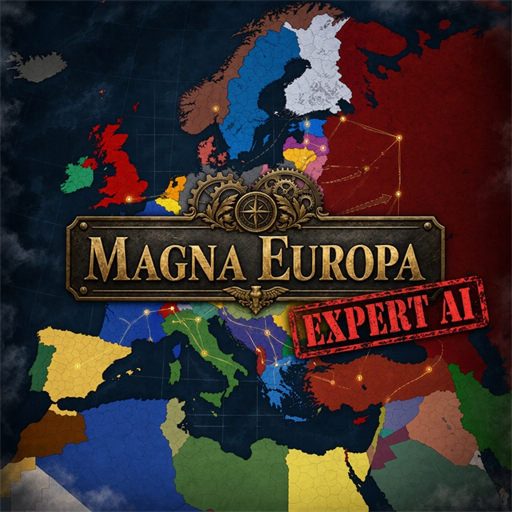

<div align="center">



# Expert AI for Magna Europa: Reforged


[](https://steamcommunity.com/sharedfiles/filedetails/?id=3845750082)

[English](README.md) | **简体中文**

**专为 [Magna Europa: Reforged](https://steamcommunity.com/sharedfiles/filedetails/?id=3809580289) 独立打造的《钢铁雄心4》高难 AI 子模组。**

**面向《Magna Europa》2,986 个地区、约 21,600 个省份的欧洲高密度大地图，全面重铸 AI 的国家运营、军工产线、师团编成、谍报系统与战区级作战指挥——默认标准档不附带任何数值作弊。**

</div>

> [!NOTE]
> **独立运行与致敬声明**：本子模组受经典高难 AI 模组 **Expert AI 5.0** 的工程哲学启发并向其致敬（外置状态机控制、Meta 装备蓝图、标准化编成、分角色师团软上限、战区扇区指挥与情报动态反制）。全部脚本、编制、国策规划与地图图论数据均针对 **Magna Europa: Reforged** 完全独立编写，**无需订阅原版 Expert AI 5.0 即可独立运行**。

> [!IMPORTANT]
> **默认公平高难**：在默认的**标准档（Standard）**下，AI **不会获得任何隐藏的攻防、产能或人力数值加成**。所有可选数值强化（挑战档、残酷档、阵营定向强化）默认关闭，仅在玩家通过自定义游戏规则或局内控制面板主动开启时生效。

---

## 模组定位与解决的问题

《Magna Europa》将欧洲主战场扩展至 **2,986 个地区、约 21,600 个省份与 253 个战略区域**，前线跨度与补给纵深约为原版的 2–2.5 倍。原版逻辑的 AI 在该地图尺度下容易出现以下短板：

- 国家国策顺序、内阁顾问、MIO 及各 DLC 专属机制（梅福券/征服经济、斯大林偏执度、谍报合作政府、合成橡胶）利用不充分；
- 装备蓝图落后、编制补给过重、后期师团无限膨胀导致游戏帧率下降；
- 战区缺乏明确主攻方向，装甲与空军力量分散，难以围绕铁路补给枢纽组织连续攻势。

**Expert AI for Magna Europa: Reforged** 在开局自动设置 `MER_EAI_enabled` 全局标志，零冲突接管本体 AI 节奏脚本，为《Magna Europa》提供一套面向大地图尺度专门调校的 AI 决策体系。

---

## 核心功能

### 1. 大国运营与原版机制深度利用

- **德国（历史四年计划路线）**：
  - 遵循历史「四年计划」路线，主动通过控价决议与战利品控制梅福券 / 征服经济消费品膨胀；在法国投降瞬间、维希法国分裂前合法执行全境黄金征用（正常支付 PP 并承担顺从度/抵抗度代价）。
  - 优化核心圈人选与推进节奏（赫斯 → 戈培尔 → 托特，并在事件触发后原地切换施佩尔），避开低收益分支。
  - 使用纯骑兵镇压编制以规避支援装备损耗向上取整问题；配置确定性 MIO、对法/对苏合作政府，并强化大西洋壁垒沿海守备。
- **苏联（历史路线）**：
  - 精确排期大清洗期间的国策顺序，并结合周检偏执度决议管控（优先使用「伪造生产报告」，必要时以「海军审查」兜底），将偏执度稳定压在随机清洗阈值之下，从而避免陆军与空军遭受随机大清洗，保全主要将领与飞机设计局。
  - 提前完成「斩蛇头」国策并提高刺杀托洛茨基的谍报优先级，尽早消除前期的稳定度与政治点数惩罚。
  - 针对《Magna Europa》地图天然橡胶稀缺的问题，在乌克兰/白俄罗斯之外的安全后方提前建设合成橡胶厂并优先研发橡胶加工科技，消除战时军工缺橡胶停工瓶颈。
  - 战前完成红空军改革分支；保留 1941 年巴巴罗萨初期的真实历史承压（绝不在战前提前修筑第聂伯河防线），开战后立即执行「绝境求生 → 工业西迁乌拉尔 → 莫斯科保卫战 → 战争的教训」，并持续通过训练队列向后方补充战略预备队。
- **意大利、同盟国与欧洲次要国**：
  - 强化意大利在希腊、巴尔干与北非战区的陆海空协同。
  - 调整英美同盟国作战节奏，优先推进北非登陆（火炬行动）后再组织大规模西欧反攻，并改善美英战时租借协同。
  - 优化英、美、法、意、波、罗、匈等主要欧洲国家的历史国策顺序与战时经济动员。

### 2. 装备设计、师团编制与动态产线闭环

- **陆空海 Meta 装备蓝图**：适配 NSB 坦克设计器、BBA 飞机设计器与 MtG 海军设计器，提供现代化的中坦、喷火支援坦、战斗机、密接支援机，以及意/英/美主要海军舰艇设计。
- **适配补给的标准化编制**：针对《Magna Europa》补给枢纽与战宽设计的步兵、摩托化、中型装甲、山地、海军陆战队与驻防编制。
- **迟滞式动态缺口产线**：实时监控步枪、火炮、反坦克炮、防空炮、支援装备、卡车、火车、坦克、战斗机与密接支援机的库存和战地缺口，采用双阈值迟滞开关避免产线频繁切换损失生产效率。
- **可调师团软上限**：按《Magna Europa》2–2.5× 战线规模约束步兵与装甲师数量，抑制后期 AI 无节制堆师造成的卡顿，同时将富余产能导入装甲部队与制空机群。

### 3. 预编译地图图论与战区作战指挥

- **离线预编译 CSR 地图邻接表**：由离线脚本 `tools/build_eai_map_graph.py` 预编译全图 2,986 州与 253 战区的压缩稀疏行（CSR）邻接数据并写入静态数组，运行时零 `meta_effect` 开销。
- **铁路枢纽重点攻势**：主要大国动态评估战线前方的敌方铁路补给枢纽，在 13 个欧洲作战扇区内集中装甲集群与制空/CAS 力量发起阶段性主攻，并在受阻时自动轮换目标。
- **仅限战时的大河定向筑垒**：仅在真实战时威胁下，由 AI 使用正常民用工厂沿欧洲 7 条主要河流（莱茵河、维斯瓦河、第聂伯河、伏尔加河、顿河、波河、多瑙河）修筑适度定向要塞。
- **谍报与反间谍协同**：规范 La Résistance 情报机构升级方向（密码学、行动分支、额外特工槽），主动执行破译密码、前线情报网、合作政府及反间谍任务。

### 4. 性能优先架构

- **无小时级轮询、无每日全图扫描**。
- **国家三级漏斗**：第一梯队（主要大国）执行周级战区脉冲与月级宏观调度；第二梯队（区域工业国）执行精简月级调度；第三梯队（小国）保持低开销休眠与上限约束。
- **28 天错峰调度**：将各国月度计算均匀分散至 28 个槽位，每天仅 1–2 个 AI 国家运行完整逻辑，策略触发全部基于 `O(1)` 布尔 Flag。

---

## 难度档位与局内配置

可在开局前通过 **自定义游戏规则 → Expert AI for Magna Europa** 预先设定，也可在游戏内随时打开仅人类可见的 **Expert AI：局内控制面板** 决议分类进行实时调整（支持一键隐藏面板）：

| 配置项 | 可选方案 | 说明 |
|---|---|---|
| **全局难度档位** | `标准档`（默认）/ `挑战档` / `残酷档` / `自定义` | `标准档` **无任何数值加成**；`挑战档` 赋予 AI `+15%` 工业与后勤强化；`残酷档` 赋予 `+30%` 工业、`+10%` 陆军攻防与 `+25%` 人力修正。 |
| **阵营定向强化** | `无`（默认）/ `轴心` / `苏联` / `同盟` / `玩家敌对大国` | 仅对指定对手阵营的主要 AI 施加 `+20%` 产出、`+15%` 建造、`-10%` 补给消耗与 `+5%` 攻防，避免友军 AI 过度膨胀。 |
| **师团软上限** | `开启`（默认）/ `放宽 (+25%)` / `关闭` | 在战线兵力密度与后期游戏流畅度之间按需取舍。 |
| **大河定向筑垒** | `开启`（默认）/ `关闭` | 开关 AI 在欧洲 7 条主要河流上的战时定向筑垒逻辑。 |

所有游戏规则、开局欢迎事件与局内控制面板均内置完整的 **简体中文** 与 **English** 双语本地化。

---

## 依赖与安装

### 所需模组

| 模组 | 说明 |
|---|---|
| [Magna Europa: Reforged](https://steamcommunity.com/sharedfiles/filedetails/?id=3809580289) | 必需本体模组（`HoI4 1.20.*`） |
| [Expert AI for Magna Europa: Reforged](https://steamcommunity.com/sharedfiles/filedetails/?id=3845750082) | 排序位于本体之后（`dependencies` 已自动声明依赖顺序） |

### 本地 / Git 仓库安装

1. 克隆或拉取本仓库（`AzurCrystal/Magna-Europa`）。
2. 将 `mods/Expert-AI-for-Magna-Europa/Expert AI for Magna Europa.mod` 复制到启动器模组目录：
   ```
   Documents/Paradox Interactive/Hearts of Iron IV/mod/
   ```
3. 编辑 **`mod/` 目录中副本**里的 `path=` 行，指向你本机仓库中的子模组目录：
   ```
   path="D:/Projects/Magna-Europa/mods/Expert-AI-for-Magna-Europa"
   ```
4. 在 Paradox 启动器播放集中同时启用 **Magna Europa: Reforged** 与 **Expert AI for Magna Europa: Reforged** 即可。

---

## 兼容性与当前版本范围（`v0.1.0`）

- **适配游戏版本**：《钢铁雄心4》**1.20.\***（*Operation Postern* + *To The Bitter End*）。
- **无冲突接管**：开局自动设置 `MER_EAI_enabled` 平滑接管本体 AI 节奏脚本，不覆盖本体地图、历史与事件文件；新开档可自由启用或卸载（请勿在存档中途增删）。
- **不兼容项**：请勿与原版 *Expert AI 5.0* 或其他 AI 大修类模组同时启用。
- **当前版本范围（`v0.1.0`）**：已完成核心错峰框架、CSR 地图图论引擎、动态产线闭环、谍报系统、难度配置框架，以及**德国**与**苏联**两国的深度历史线打磨，并通过 1936–1943 全周期观战实测与 `-debug` 零新增报错验证。后续 `0.2.x` 版本将继续针对英国、美国、意大利及欧洲次要国做更细致的专项优化。

---

## 维护者说明：重建预编译地图数据

若本体模组更新了 `mods/Magna-Europa/map/` 下的省份、地区、铁路或补给节点，请在仓库根目录重新运行编译器以同步地图图论与大河防线数据：

```bash
python tools/build_eai_map_graph.py
```

---

## 致谢

- **Expert AI 5.0** —— 致敬其在《钢铁雄心4》高难 AI 工程设计上的开创性架构与理念。
- **[Magna Europa: Reforged](https://steamcommunity.com/sharedfiles/filedetails/?id=3809580289)** —— 本体地图重制与全 DLC 内容移植基础。
- **Paradox Interactive** —— 《钢铁雄心4》游戏本体及各扩展机制。
